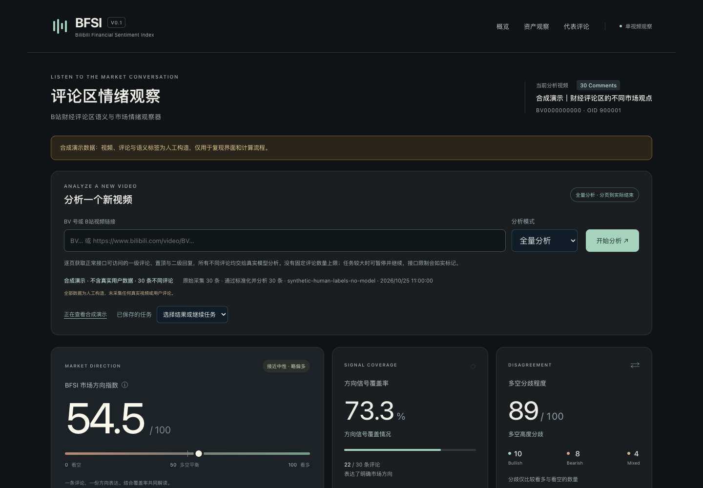
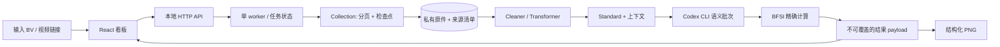

# BFSI · B站财经评论区情绪观察器

**Bilibili Financial Sentiment Index** — 从一个 BV 号出发，把评论采集、上下文保留、LLM 语义标注、情绪指数和可分享看板连接起来的本地应用。

财经评论中，“情绪强烈”“讨论财经”和“明确看多/看空”是不同信号。BFSI 将它们分别展示，并同时报告方向信号覆盖率与多空分歧，帮助观察评论区表达。项目用于探索评论分析与工程实现，不能据此推断市场走势。

源码按采集、标准化、语义、指数、服务与出图划分。示例、截图和评论均为人工合成；真实采集结果与模型记录只保存在本地运行目录。尚未选择开源许可，参见 [许可说明](docs/LICENSING.md)。



## 可以做什么

- 输入 BV 号或 B站视频链接，创建独立分析任务。
- 快速模式选择 20/50/100/200 条样本；全量模式持续分页到接口实际结束，没有固定 200 条上限。
- 采集一级评论、置顶评论与二级回复，按不同 Comment ID 去重，保留重复出现的 Observation 和父链上下文。
- Cleaner / Transformer 执行冻结 Schema、业务关系和原件指纹校验；缺失父链或异常来源不会被静默补造。
- 通过本机 Codex CLI 批量执行语义推理，校验输出标签、评论 ID、执行事件和输入哈希；支持暂停、续跑与成功批次复用。
- 展示 BFSI、方向覆盖率、多空分歧、财经相关性、对象提及和代表评论。
- 根据结果数据重新排版，导出 1080px 宽的单张纵向 PNG，而非滚动网页截图。
- 提供完全离线、无需登录或模型调用的合成演示与测试。

## 从哪里读代码

| 你关心的问题 | 入口 |
| --- | --- |
| BV 如何解析、如何分页与续采 | [`collection/collector.py`](src/bfsi/collection/collector.py) |
| 原件如何变成 Standard、如何保留上下文 | [`transform/`](src/bfsi/transform/)、[Schema 文档](docs/SCHEMAS.md) |
| 模型输入、校验、重试与续跑 | [`semantic/runner.py`](src/bfsi/semantic/runner.py) |
| 指数公式与聚合口径 | [`index/math.py`](src/bfsi/index/math.py)、[方法说明](docs/METHODOLOGY.md) |
| 单机任务状态和 API | [`server/jobs.py`](src/bfsi/server/jobs.py)、[`server/http.py`](src/bfsi/server/http.py) |
| 看板和分享图片 | [`web/src/`](web/src/)、[`reporting/poster.py`](src/bfsi/reporting/poster.py) |

```text
src/bfsi/
  collection/       BV 解析、HTTP/WBI、分页、浏览器文件桥
  transform/        Cleaner、Transformer、Schema/业务/raw 校验
  semantic/         文本模型批次、冻结输入、续跑与完整性检查
  index/            精确公式、去重聚合、看板 payload
  server/           本地 HTTP API、串行任务 worker
  reporting/        结构化 PNG 海报
  resources/        运行所需的冻结契约、Prompt、通用别名
  config.py         资源位置与私有运行目录
web/                React + TypeScript + Vite
schemas/            可直接阅读的 JSON Schema
tests/              离线回归、API、全链路测试
docs/               架构、契约、方法、迁移和发布说明
scripts/            安装、启动、合成演示与发布检查
examples/demo/      可重复生成的合成语义数据与 payload
var/                本地运行产物，Git 忽略
```

## 架构与数据流



服务只监听 `127.0.0.1`。静态目录只包含构建后的前端；运行数据、原始评论和模型日志不作为静态文件提供。更详细的边界和接口见 [架构说明](docs/ARCHITECTURE.md)。

## 安装与运行

需要 Python 3.11+、Node.js 22.12+ 和 pnpm 11.25.0。迁移在 macOS / Python 3.12 / Node 24 上验证。当前语义模块使用 `fcntl` 文件锁，面向 macOS/Linux；Windows 原生运行尚未支持，可使用 WSL。图片导出需要中文字体，macOS 默认可用苹方，Linux 可安装 Noto CJK。

在仓库根目录执行：

```bash
./scripts/setup.sh
./scripts/start.sh
```

浏览器打开 `http://127.0.0.1:8787/`。首次打开会显示明确标注的合成示例。完成安装后，也可双击根目录 `启动 BFSI.command`。修改前端后运行 `pnpm --dir web run build`，再刷新页面。

Python 使用常规包安装，修改 Python 源码后运行 `.venv/bin/python -m pip install .` 重新安装。直接运行 `bfsi` 或 `python -m bfsi.server` 时，请在仓库根目录执行；启动脚本会自动切换目录并配置资源根目录。

如果只想检查作品和图片导出，无需登录模型：

```bash
source .venv/bin/activate
python scripts/demo.py --check
python scripts/demo.py --install
python -m bfsi.server --no-open --port 8787
```

`--install` 只创建固定 ID 的本地合成任务并将其设为最近结果，不采集、不调用模型。随后可在页面点击“导出结果图”。[合成分享图](docs/images/result-poster.png)可直接查看。

### 分析真实视频

本机需另行安装并登录可用的 Codex CLI，`codex` 在 PATH 上，或通过 `BFSI_CODEX_CLI` 指定可执行文件。现有实现使用 `codex exec` 的文本输出与事件流协议，并保留原项目的默认模型配置；不同 CLI 版本或账号的模型权限可能不同。可用 `BFSI_MODEL` 指定你已有权限的模型。模型调用会消耗相应额度；本仓库不含账号、Cookie 或 API 密钥。

```bash
export BFSI_MODEL='你的账号可用的模型名称'
./scripts/start.sh
```

输入真实 BV，选择模式并开始。平台登录、验证码、权限或风控限制会停止/暂停任务并保留已有证据；普通 HTTP 采集不会继承 Chrome 登录态。浏览器文件桥是单独的高级接入器，不会自动控制浏览器，见 [运行指南](docs/RUNNING.md)。

### 配置

| 环境变量 | 默认 / 用途 |
| --- | --- |
| `BFSI_DATA_DIR` | 仓库 `var/`；所有任务、原件、模型记录和图片所在的私有目录 |
| `BFSI_PROJECT_ROOT` | 源码仓库根目录；启动脚本自动设置，直接命令需在根目录执行 |
| `BFSI_CODEX_CLI` | PATH 中的 `codex`；也兼容现有 macOS 应用捆绑 CLI |
| `BFSI_MODEL` | 沿用原实现默认值；同一任务恢复必须保持冻结配置 |
| `BFSI_POSTER_FONT` | 显式指定中文字体文件 |
| `BFSI_TIMEZONE` | 海报时间显示，默认 UTC，可指定 IANA 时区 |
| `BFSI_COLLECTION_BURST_REQUESTS` | 默认 80 次请求后冷却 |
| `BFSI_COLLECTION_COOLDOWN_SECONDS` | 默认冷却 5 秒 |

`.env.example` 是配置说明文件，应用不会自动加载 `.env`。

## 复现与验证

```bash
source .venv/bin/activate
python scripts/demo.py --check
python -B -m unittest discover -s tests -v
pnpm --dir web run build
pnpm --dir web run verify:data
pnpm --dir web exec playwright install chromium
pnpm --dir web run test:browser
python scripts/check_public.py
```

离线测试替换网络与模型边界，保留真实的转换、校验、批次、计算与出图逻辑。浏览器测试覆盖合成 API 契约、全量/快速模式、暂停/恢复、无信号状态和手机布局；[验证报告](docs/VERIFICATION.md)记录本次实际运行结果与外部验证边界。GitHub Actions 提供同样的离线检查流程，当前远端结果见 [Actions](https://github.com/SushiFushi0030/bfsi/actions/workflows/ci.yml)。

## 指数口径与局限

令 `B/S/M` 为看多、看空、混合方向的不同评论数：`BFSI = 50 + 50 × (B-S)/(B+S+M)`。没有方向评论时，公式占位 50，界面显示“暂无方向信号”。不按点赞数或重复出现次数加权，不把财经相关性当作主指数过滤条件。需要同时阅读覆盖率 `(B+S+M)/N` 和分歧 `1-|B-S|/(B+S)`，详见 [方法说明](docs/METHODOLOGY.md)。

- “全量”表示本次接口可访问并通过完整性校验的集合，不保证等于平台显示总数，也不包含未来评论。部分采集会明确标注。
- 语义标签来自模型，尚未建立独立人工标注测试集和准确率评估；讽刺、隐含立场、历史交易与条件表达可能误判。
- 对象指数使用“同一评论中对象与整体立场共现”的近似，不是对象级立场标注。代表评论为确定性标签筛选，并不代表统计抽样。
- 任务单机串行，模型每批 10 条、最多 2 批并行。全量分析的成本和时间随评论量增长。
- 崩溃发生在模型返回但成功记录尚未提交时，恢复可能重复一次调用，不能保证严格一次执行。
- 标准化去除账号结构字段，但保留评论原文及评论关系 ID，不能视为匿名化；真实海报也可能包含用户原文。发布副本只使用合成数据。

## 迁移与公开发布

旧开发阶段目录对应的新入口见 [迁移映射](docs/MIGRATION.md)。原 Task、生产目录和冻结样本保留在本地，发布副本不依赖它们，也不包含它们的 Git 历史。

发布前阅读 [安全说明](docs/SECURITY.md)、[许可选择](docs/LICENSING.md)和 [GitHub 发布步骤](docs/PUBLISHING.md)。正式仓库：[SushiFushi0030/bfsi](https://github.com/SushiFushi0030/bfsi)。这是需要本地运行的工具，公开源码不代表已经部署在线服务。尚未指定 LICENSE，公开浏览不等于授予开源复用许可。
